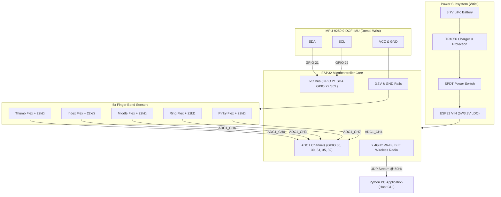

# Circuit Diagram & Electrical Wiring
## ASL Glove to Nigerian Languages Translation System

This document contains complete schematic diagrams, pinout wiring tables, and circuit topologies for both the **Left Hand Glove** and **Right Hand Glove**.

---

### 1. Dual-Glove Circuit Architecture Overview

Both gloves share an identical electrical topology, differing only in the firmware identity tag (`LEFT` vs `RIGHT`) and the physical mounting orientation on the glove back.



---

### 2. Detailed Pinout & Connection Table

#### Per-Glove Pin Table (Applies to Left & Right ESP32 Modules)

| Sensor / Module | Sensor Pin | ESP32 GPIO Pin | Function / Type | Note |
| :--- | :--- | :--- | :--- | :--- |
| **Thumb Flex** | Out (Divider) | **GPIO 36 (VP / SVP)** | ADC1_CH0 | Analog input only, 12-bit ADC |
| **Index Flex** | Out (Divider) | **GPIO 39 (VN / SVN)** | ADC1_CH3 | Analog input only, 12-bit ADC |
| **Middle Flex** | Out (Divider) | **GPIO 34** | ADC1_CH6 | Analog input only, 12-bit ADC |
| **Ring Flex** | Out (Divider) | **GPIO 35** | ADC1_CH7 | Analog input only, 12-bit ADC |
| **Pinky Flex** | Out (Divider) | **GPIO 32** | ADC1_CH4 | Analog input / digital GPIO |
| **MPU-9250** | SDA | **GPIO 21** | I2C Data | 4.7kΩ pull-up to 3.3V (included on module) |
| **MPU-9250** | SCL | **GPIO 22** | I2C Clock | 4.7kΩ pull-up to 3.3V (included on module) |
| **MPU-9250** | VCC | **3.3V** | Power (3.3V) | Do NOT connect to 5V! |
| **MPU-9250** | GND | **GND** | Ground | Common system ground |
| **MPU-9250** | AD0 | **GND** | I2C Address Select | Address: `0x68` (or 3.3V for `0x69`) |
| **Power Input** | OUT+ (TP4056)| **VIN / 5V** | Power In | Through SPDT slide switch |
| **Power Ground**| OUT- (TP4056)| **GND** | Common Ground | Connected to ESP32 and sensor grounds |

---

### 3. Flex Sensor Voltage Divider Circuit

Each flex sensor is configured as an upper resistor in a voltage divider network with a 22 kΩ precision metal-film pull-down resistor:

```text
       +3.3V (ESP32 Regulated Output)
         │
         ├───┐
         │   │
        ┌┴┐ ┌┴┐
        │ │ │ │ Flex Sensor (Finger dorsal side)
        │ │ │ │ (10kΩ Flat ────> 60kΩ-100kΩ Bent)
        └┬┘ └┬┘
         │   │
         └───┼───────────────────────> ESP32 ADC Input Pin (e.g., GPIO 36 / SVP)
             │
            ┌┴┐
            │ │ R_ref (22 kΩ Pull-Down Resistor)
            │ │
            └┬┘
             │
            GND (Common Ground)
```

#### Repeated 5 times across the hand:
* **Finger 1 (Thumb):** Flex 1 -> junction to **GPIO 36 (SVP)** -> 22kΩ to GND
* **Finger 2 (Index):** Flex 2 -> junction to **GPIO 39 (SVN)** -> 22kΩ to GND
* **Finger 3 (Middle):** Flex 3 -> junction to **GPIO 34** -> 22kΩ to GND
* **Finger 4 (Ring):** Flex 4 -> junction to **GPIO 35** -> 22kΩ to GND
* **Finger 5 (Pinky):** Flex 5 -> junction to **GPIO 32** -> 22kΩ to GND

---

### 4. MPU-9250 9-DOF IMU Wiring & Physical Mounting

The MPU-9250 is oriented flat on the back of the hand (dorsal carpals) with the **+Y axis pointing away from the fingers (towards the wrist/forearm)** and the **+Z axis pointing perpendicular up** from the dorsal surface.

```text
   Hand Orientation:
   [Fingers (-Y)] <====== [Back of Hand / MPU-9250 (+Z up)] ======> [Wrist / Forearm (+Y)]

```text
   MPU-9250 Module                ESP32 Development Board
  ┌──────────────┐               ┌────────────────────────┐
  │  VCC         ├───────────────┤ 3.3V                   │
  │  GND         ├───────────────┤ GND                    │
  │  SCL         ├───────────────┤ GPIO 22 (I2C SCL)      │
  │  SDA         ├───────────────┤ GPIO 21 (I2C SDA)      │
  │  AD0         ├───────┐       │                        │
  │  INT         │ (N/C) │       │                        │
  └──────────────┘       │       └────────────────────────┘
                        GND (sets I2C address = 0x68)
```

---

### 5. Battery and Power Management Circuit

```text
 3.7V LiPo Battery
 ┌───────────────┐
 │ (+) Red Wire  ├───────┐
 │ (-) Black Wire├──┐    │
 └───────────────┘  │    │
                    │    │
             B-  ───┘    └─── B+
           ┌────────────────────────┐
           │     TP4056 Module      │  (Charge via Micro-USB/Type-C)
           │                        │
           │ OUT-              OUT+ │
           └───┬──────────────────┬─┘
               │                  │
               │                  └───┐ [SPDT Slide Switch]
               │                      ├─── (ON) ────────────> ESP32 VIN (Pin 5V/VIN)
               │                      └─── (OFF)
               │
               └────────────────────────────────────────────> ESP32 GND
```

---

### 6. Safety & Noise Mitigation Recommendations

1. **Filtering Capacitors:** Place a $0.1\,\mu\text{F}$ (100nF) ceramic capacitor between each ADC input pin and GND. This drastically eliminates high-frequency noise induced by ESP32 Wi-Fi RF bursts.
2. **Wire Strain Relief:** Flex sensor solder pins are fragile. Apply heat-shrink tubing and epoxy/hot glue reinforcement over the sensor solder tabs before securing onto the glove fabric.
3. **I2C Pull-Up Resistors:** Most breakout modules have built-in 4.7kΩ resistors on SDA and SCL. Ensure no secondary duplicate pull-ups are added which could overload bus drive capability.
